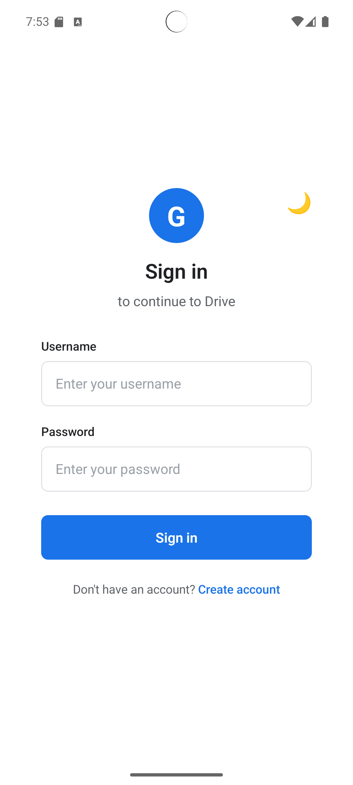
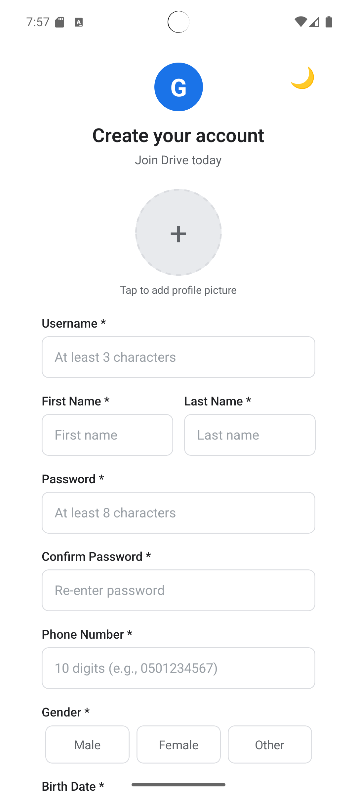
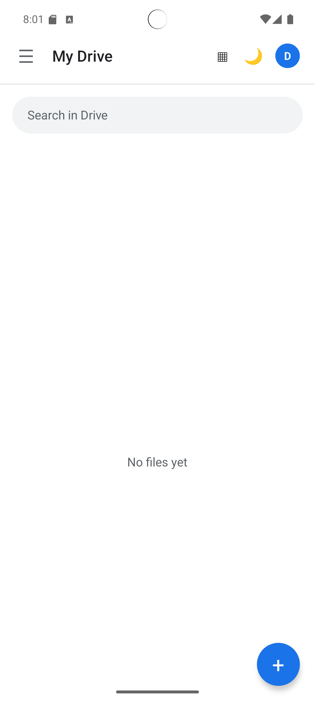
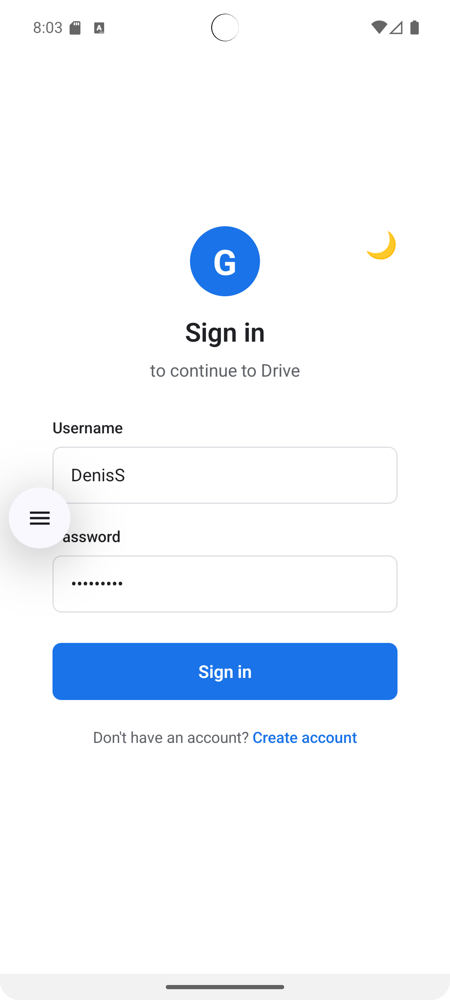
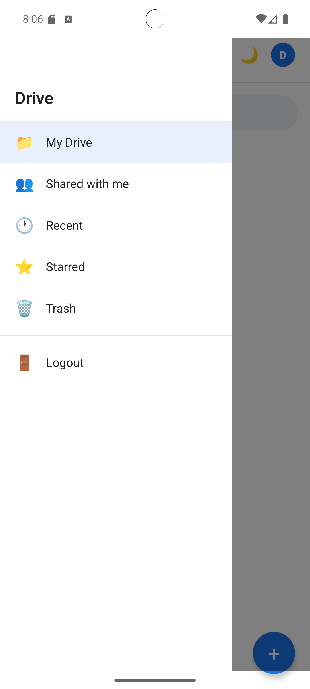
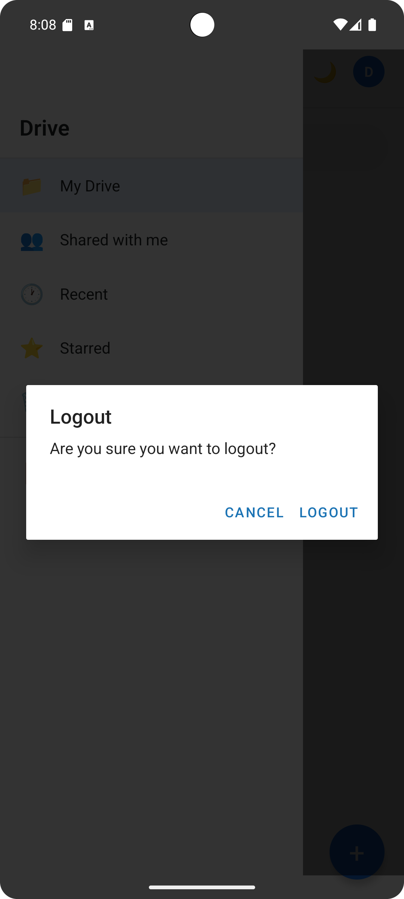
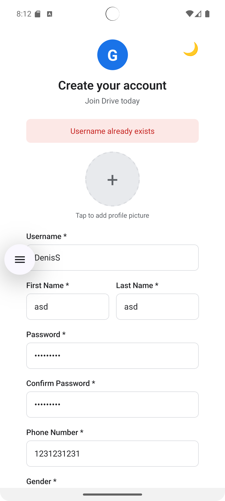
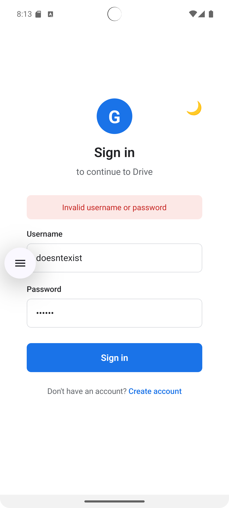

# Authentication

This guide covers the user registration and login processes in the Drive App.

## Overview

The Drive App uses JWT (JSON Web Token) authentication:
- Users register with username, password, and profile information
- Users login with username and password
- A JWT token is issued and stored for authenticated requests

## Registration Process

### Step 1: Open the App

When you first open the app, you'll see the Login screen.


*Screenshot: Initial login screen*

### Step 2: Navigate to Registration

Tap **"Create account"** at the bottom of the login screen.


*Screenshot: Create account link*

### Step 3: Fill Registration Form

Complete all required fields:

| Field | Requirements |
|-------|--------------|
| Profile Picture | Optional - tap to select from camera or gallery |
| Username | Minimum 3 characters, unique |
| First Name | Required |
| Last Name | Required |
| Password | Minimum 8 characters |
| Confirm Password | Must match password |
| Phone Number | 10 digits (e.g., 0501234567) |
| Gender | Select: Male, Female, or Other |
| Birth Date | Format: YYYY-MM-DD |


*Screenshot: Registration form fields*

### Step 4: Add Profile Picture (Optional)

Tap the profile picture placeholder to add a photo:

1. Select **Camera** to take a new photo
2. Select **Gallery** to choose existing photo


*Screenshot: Profile picture selection options*

### Step 5: Submit Registration

Tap **"Create account"** button.


*Screenshot: Create account button*

### Step 6: Registration Success

On successful registration, you'll be automatically logged in and redirected to the Home screen.


*Screenshot: Successful registration - Home screen*

## Login Process

### Step 1: Enter Credentials

On the login screen, enter:
- **Username** - Your registered username
- **Password** - Your password


*Screenshot: Login form with credentials*

### Step 2: Tap Sign In

Tap the **"Sign in"** button.


*Screenshot: Sign in button*

### Step 3: Login Success

On successful login, you'll be redirected to the Home screen showing your files.


*Screenshot: Successful login - Home screen with files*

## Logout Process

### Step 1: Open Menu

Tap the **hamburger menu** (☰) icon in the top-left corner.


*Screenshot: Menu icon location*

### Step 2: Select Logout

Scroll down in the drawer menu and tap **"Logout"**.


*Screenshot: Logout option in menu*

### Step 3: Confirm Logout

A confirmation dialog will appear. Tap **"Logout"** to confirm.


*Screenshot: Logout confirmation dialog*

### Step 4: Return to Login

You'll be redirected to the Login screen.

## Error Handling

### Registration Errors

| Error | Cause | Solution |
|-------|-------|----------|
| "Username already exists" | Username taken | Choose a different username |
| "Password too short" | Less than 8 characters | Use longer password |
| "Passwords don't match" | Confirm password different | Re-enter matching password |
| "Invalid phone number" | Wrong format | Use 10 digits |


*Screenshot: Registration validation error*

### Login Errors

| Error | Cause | Solution |
|-------|-------|----------|
| "Invalid credentials" | Wrong username/password | Check your credentials |
| "Network error" | Backend not reachable | Verify backend is running |


*Screenshot: Login error message*

## Session Management

- Sessions are stored locally using AsyncStorage
- Sessions persist across app restarts
- Tokens expire after extended inactivity

## API Endpoints

### Register
```
POST /api/users
Content-Type: application/json

{
  "username": "john",
  "password": "password123",
  "firstName": "John",
  "lastName": "Doe",
  "phoneNumber": "0501234567",
  "gender": "male",
  "birthDate": "1990-01-15",
  "image": "data:image/jpeg;base64,..."
}
```

### Login
```
POST /api/users/tokens
Content-Type: application/json

{
  "username": "john",
  "password": "password123"
}
```

Response:
```json
{
  "token": "eyJhbGciOiJIUzI1NiIs...",
  "user": {
    "id": "...",
    "username": "john",
    "firstName": "John",
    "lastName": "Doe"
  }
}
```

---

Next: [File Operations](File-Operations.md)
