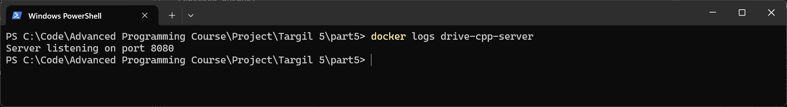
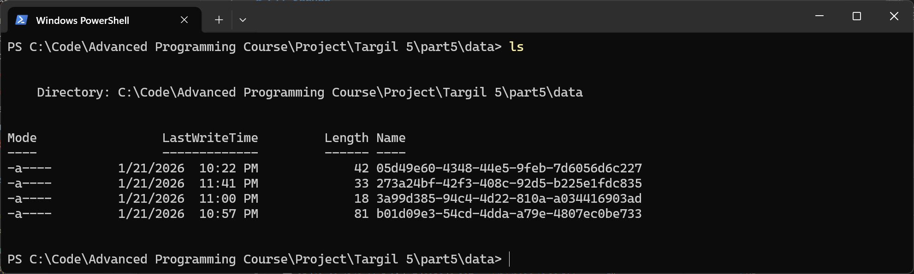
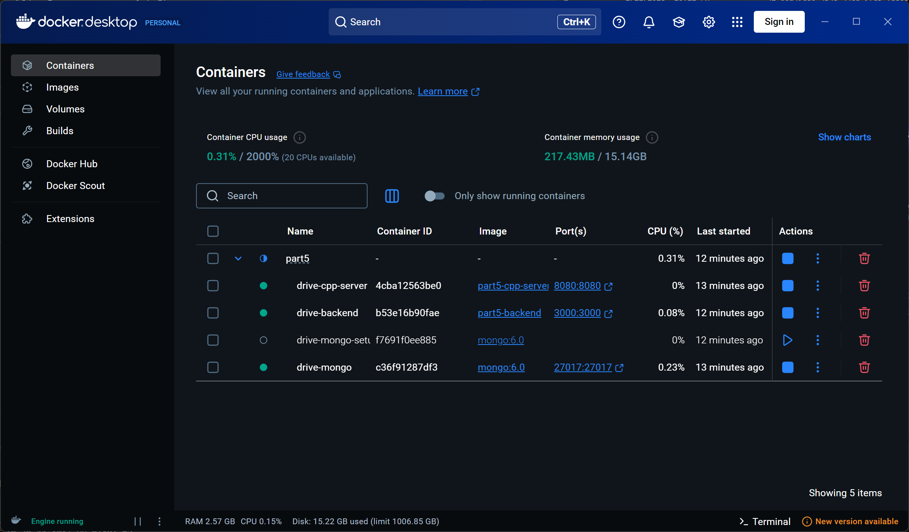

# C++ Server

This guide covers the C++ file storage server that handles file storage with RLE compression.

## Overview

The C++ server provides:
- TCP-based file storage service
- Run-Length Encoding (RLE) compression
- File CRUD operations
- Content search functionality

## Architecture

```
┌─────────────────┐     TCP (Port 8080)     ┌─────────────────┐
│  Express API    │ ─────────────────────▶  │   C++ Server    │
│                 │                          │                 │
│  fileController │     Commands:            │  - Server.cpp   │
│  socketService  │     post/get/delete      │  - Compressor   │
└─────────────────┘                          │  - Commands     │
                                             └────────┬────────┘
                                                      │
                                                      ▼
                                             ┌─────────────────┐
                                             │   /data/        │
                                             │  File Storage   │
                                             │  (Compressed)   │
                                             └─────────────────┘
```

## Commands

The C++ server accepts the following TCP commands:

### POST - Store File
```
post <storageKey> <data>
```

**Example:**
```
post abc123-uuid-here SGVsbG8gV29ybGQ=
```

**Response:**
```
200 OK
```

### GET - Retrieve File
```
get <storageKey>
```

**Example:**
```
get abc123-uuid-here
```

**Response:**
```
200 Hello World
```

### DELETE - Remove File
```
delete <storageKey>
```

**Example:**
```
delete abc123-uuid-here
```

**Response:**
```
200 OK
```

### SEARCH - Search Content
```
search <query>
```

**Example:**
```
search hello
```

**Response:**
```
200 abc123-uuid,def456-uuid
```

## RLE Compression

The server uses Run-Length Encoding to compress file data.

### How RLE Works

```
Original:  AAABBBCCCC
Encoded:   A3B3C4

Original:  Hello
Encoded:   H1e1l2o1
```

### Compression Process

1. File data received from Express
2. Data compressed using RLE
3. Compressed data saved to disk

### Decompression Process

1. Request received for file
2. Compressed data read from disk
3. Data decompressed using RLE
4. Original content returned

## File Storage

### Storage Location

Files are stored in the `/data` directory:

```
/data/
├── abc123-uuid-here     # Compressed file 1
├── def456-uuid-here     # Compressed file 2
└── ghi789-uuid-here     # Compressed file 3
```

### Storage Key

Each file is identified by a UUID (storageKey):
- Generated when file is created
- Stored in MongoDB file metadata
- Used to reference file in C++ server

## Express Integration

### socketService.js

The Express backend communicates with C++ server via TCP:

```javascript
// express-server/services/socketService.js

const net = require('net');

const sendToCppEngine = (command) => {
  return new Promise((resolve, reject) => {
    const client = new net.Socket();
    const host = process.env.CPP_SERVER_HOST || 'localhost';
    const port = process.env.CPP_SERVER_PORT || 8080;

    client.connect(port, host, () => {
      client.write(command);
    });

    client.on('data', (data) => {
      resolve(data.toString());
      client.destroy();
    });

    client.on('error', (err) => {
      reject(err);
    });
  });
};
```

### fileController.js Integration

```javascript
// Creating a file
const createFile = async (req, res) => {
  // 1. Create metadata in MongoDB
  const newFile = new File({
    name: req.body.name,
    userId: req.userId,
    storageKey: uuid.v4(),  // Generate unique key
    isFolder: false
  });
  await newFile.save();

  // 2. Store content in C++ server
  const escapedData = escapeData(req.body.data || '');
  await sendToCppEngine(`post ${newFile.storageKey} ${escapedData}`);

  res.status(201).json(newFile);
};

// Retrieving a file
const getFileById = async (req, res) => {
  // 1. Get metadata from MongoDB
  const file = await File.findById(req.params.id);

  // 2. Get content from C++ server
  const response = await sendToCppEngine(`get ${file.storageKey}`);
  const parsed = parseResponse(response);

  res.json({
    ...file.toObject(),
    data: parsed.content
  });
};
```

## Docker Configuration

### Dockerfile

```dockerfile
FROM gcc:latest

WORKDIR /app

COPY src/ ./src/
COPY tests/ ./tests/

RUN g++ -o server src/*.cpp -pthread

ENV DATA_DIR=/data

EXPOSE 8080

CMD ["./server"]
```

### docker-compose.mobile.yml

```yaml
services:
  cpp-server:
    build:
      context: .
      dockerfile: Dockerfile
    container_name: drive-cpp-server
    ports:
      - "8080:8080"
    volumes:
      - ./data:/data
    environment:
      - DATA_DIR=/data
```

## Testing the Server

### Manual TCP Test

```bash
# Connect to C++ server
echo "post test-key SGVsbG8=" | nc localhost 8080

# Retrieve file
echo "get test-key" | nc localhost 8080

# Delete file
echo "delete test-key" | nc localhost 8080
```

### From Docker

```bash
# Check if server is running
docker logs drive-cpp-server

# Test connection
docker exec -it drive-cpp-server sh -c "echo 'get test' | nc localhost 8080"
```

## Response Codes

| Code | Meaning |
|------|---------|
| 200 | Success |
| 404 | File not found |
| 500 | Server error |

## Screenshots

### C++ Server Running

*Screenshot: C++ server console output*

### Data Directory

*Screenshot: Files stored in /data directory*

### Docker Container

*Screenshot: C++ server Docker container running*

## Troubleshooting

### Server Not Starting

```bash
# Check Docker logs
docker logs drive-cpp-server

# Verify port is available
netstat -ano | findstr :8080
```

### Connection Refused

```bash
# Ensure C++ server container is running
docker ps | grep cpp-server

# Check environment variables
docker exec drive-cpp-server env | grep CPP
```

### File Not Found

1. Verify storageKey exists in MongoDB
2. Check /data directory for file
3. Ensure volume mount is correct

### Files Not Appearing in /data

1. Check volume mount in docker-compose
2. Verify DATA_DIR environment variable
3. Check file permissions on host directory

---

Back to [Home](Home.md)
