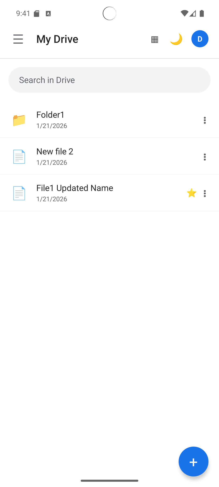
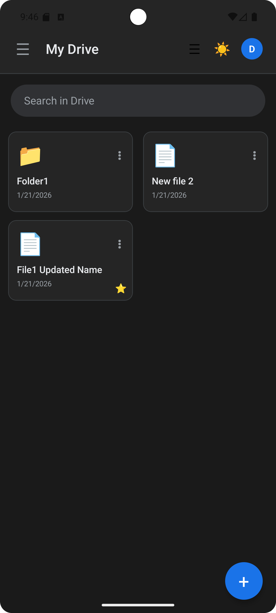

# Dark Mode

This guide covers the dark mode feature and theme customization in the Drive App.

## Overview

The Drive App supports a system-wide dark mode that applies to all screens:
- Login Screen
- Signup Screen
- Home Screen (including all modals)
- Share Screen
- Navigation Drawer

Dark mode state is shared across all screens using React Context.

## How It Works

### ThemeContext

The app uses a centralized `ThemeContext` to manage dark mode state:

```javascript
// MobileApp/src/contexts/ThemeContext.js

const ThemeContext = createContext();

export const ThemeProvider = ({ children }) => {
  const [darkMode, setDarkMode] = useState(false);

  const toggleDarkMode = () => setDarkMode(!darkMode);

  const theme = {
    bg: darkMode ? '#1a1a1a' : '#fff',
    text: darkMode ? '#e8eaed' : '#202124',
    // ... more colors
  };

  return (
    <ThemeContext.Provider value={{ theme, darkMode, toggleDarkMode }}>
      {children}
    </ThemeContext.Provider>
  );
};
```

### Using Theme in Screens

Each screen accesses the theme via the `useTheme` hook:

```javascript
import { useTheme } from '../contexts/ThemeContext';

const MyScreen = () => {
  const { theme, darkMode, toggleDarkMode } = useTheme();

  return (
    <View style={{ backgroundColor: theme.bg }}>
      <Text style={{ color: theme.text }}>Hello</Text>
    </View>
  );
};
```

## Toggling Dark Mode

### From Any Screen

Tap the sun/moon icon in the header to toggle dark mode.

### Toggle Icon

| Mode | Icon |
|------|------|
| Light Mode | 🌙 (Moon) |
| Dark Mode | ☀️ (Sun) |

## Theme Colors

### Light Mode Colors

| Property | Color | Usage |
|----------|-------|-------|
| bg | `#fff` | Main background |
| headerBg | `#fff` | Header background |
| text | `#202124` | Primary text |
| textSecondary | `#5f6368` | Secondary text |
| border | `#e0e0e0` | Borders and dividers |
| inputBg | `#fff` | Input field background |
| inputBorder | `#dadce0` | Input field border |
| modalBg | `#fff` | Modal background |
| drawerBg | `#fff` | Drawer background |

### Dark Mode Colors

| Property | Color | Usage |
|----------|-------|-------|
| bg | `#1a1a1a` | Main background |
| headerBg | `#252525` | Header background |
| text | `#e8eaed` | Primary text |
| textSecondary | `#9aa0a6` | Secondary text |
| border | `#3c4043` | Borders and dividers |
| inputBg | `#3c4043` | Input field background |
| inputBorder | `#5f6368` | Input field border |
| modalBg | `#303134` | Modal background |
| drawerBg | `#252525` | Drawer background |

## Examples with Dark Mode

### Home Screen

<br>
*Screenshot: Home screen in light mode*

<br>
*Screenshot: Home screen in dark mode*

## State Persistence

Currently, dark mode preference is:
- **Session-based** - Resets when app is restarted
- **System-aware** - Initializes based on device system theme

### Initial State

The app detects the system color scheme on startup:

```javascript
import { useColorScheme } from 'react-native';

const colorScheme = useColorScheme();
const [darkMode, setDarkMode] = useState(colorScheme === 'dark');
```

---

Back to [Home](Home.md)
