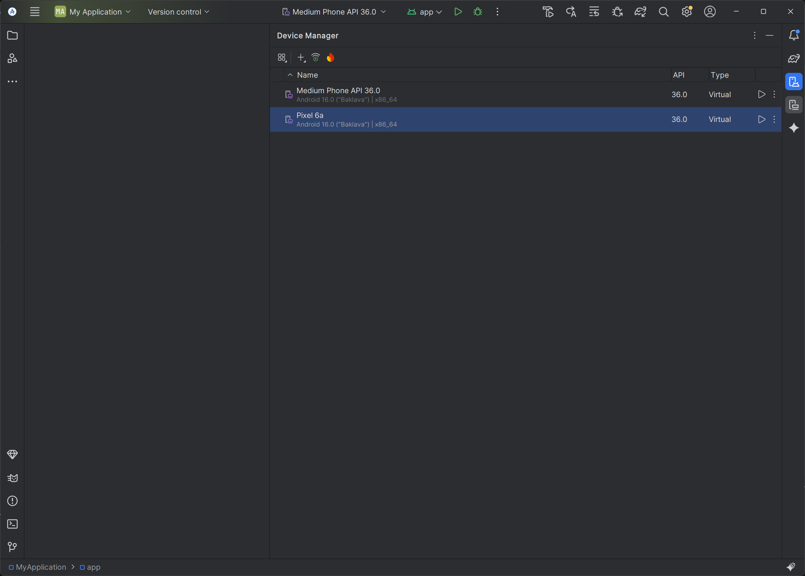

# Environment Setup

This guide covers all prerequisites and installation steps needed to run the Drive App system.

## Prerequisites

### Required Software

| Software | Version | Purpose |
|----------|---------|---------|
| Node.js | 18+ | Backend server & Mobile app |
| Docker Desktop | Latest | Container management (C++ server & Backend) |
| Android Studio | Latest | Android emulator |
| Git | Latest | Version control |
| MongoDB | 6+ | Local database (or use Docker) |

### Installation Links

- [Node.js](https://nodejs.org/)
- [Docker Desktop](https://www.docker.com/products/docker-desktop/)
- [Android Studio](https://developer.android.com/studio)
- [MongoDB Community](https://www.mongodb.com/try/download/community)

## Setup Steps

### 1. Clone the Repository

```bash
git clone <repository-url>
cd part5
```

### 2. Install Backend Dependencies

```bash
cd express-server
npm install
cd ..
```

### 3. Install Mobile App Dependencies

```bash
cd MobileApp
npm install
cd ..
```

### 5. Configure Android Emulator

1. Open Android Studio
2. Go to **Tools** → **Device Manager**
3. Create a new Virtual Device (recommended: Pixel 6, API 33+)
4. Start the emulator


*Screenshot: Android Studio Device Manager*

## Verify Installation

### Check Docker

```bash
docker --version
docker-compose --version
```

Expected output:
```
Docker version 24.x.x
Docker Compose version v2.x.x
```

### Check Node.js

```bash
node --version
npm --version
```

Expected output:
```
v18.x.x
9.x.x
```

### Check MongoDB

```bash
# If running locally
mongod --version

# Or check if service is running
netstat -ano | findstr :27017
```

### Check Android Emulator

If you have Android SDK Platform-Tools in PATH:
```bash
adb devices
```

Otherwise you need to specifically target adb.exe.

Expected output:
```
List of devices attached
emulator-5554   device
```


*Screenshot: ADB devices output*

## Project Structure After Setup

```
part5/
├── data/                    # C++ server file storage (create this)
├── express-server/
│   └── node_modules/        # After npm install
├── MobileApp/
│   └── node_modules/        # After npm install
├── src/                     # C++ server source
├── docker-compose.mobile.yml
└── Dockerfile
```

## Docker Configuration

The project uses Docker for:
- **C++ Server** - File storage with RLE compression
- **Backend** - Node.js/Express API

### docker-compose.mobile.yml Overview

```yaml
services:
  cpp-server:
    build:
      context: .
      dockerfile: Dockerfile
    ports:
      - "8080:8080"
    volumes:
      - ./data:/data        # Mount local data folder

  backend:
    build:
      context: ./express-server
      dockerfile: Dockerfile.node
    ports:
      - "3000:3000"
    environment:
      - MONGO_URI=mongodb://host.docker.internal:27017/driveDB
      - CPP_SERVER_HOST=cpp-server
      - CPP_SERVER_PORT=8080
    depends_on:
      - cpp-server
```

## Environment Variables

### Backend (express-server)

| Variable | Default | Description |
|----------|---------|-------------|
| PORT | 3000 | API server port |
| MONGO_URI | mongodb://localhost:27017/driveDB | MongoDB connection |
| JWT_SECRET | secret | JWT signing key |
| CPP_SERVER_HOST | localhost | C++ server hostname |
| CPP_SERVER_PORT | 8080 | C++ server port |

### C++ Server

| Variable | Default | Description |
|----------|---------|-------------|
| DATA_DIR | /data | File storage directory |
| PORT | 8080 | TCP server port |

## Troubleshooting

### Docker not starting
- Ensure Docker Desktop is running
- On Windows, enable WSL 2 integration
- Check Docker Desktop settings

### Emulator not detected
- Ensure Android Studio is installed with SDK tools
- Add `platform-tools` to your PATH
- Restart ADB: `adb kill-server && adb start-server`

### Network connection issues
- Ensure firewall allows connections on ports 3000, 8080, and 8081
- Use your machine's actual IP, not `localhost`
- Check that all services are running

### MongoDB connection failed
- Verify MongoDB is running on port 27017
- Check if MongoDB service is started
- For Docker: uses `host.docker.internal` to connect

### C++ server build fails
- Ensure Docker has sufficient resources
- Check Dockerfile syntax
- Verify gcc is available in Docker image

---

Next: [Running the System](Running-the-System.md)
