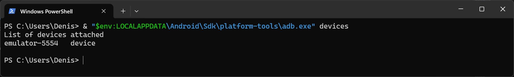

# Environment Setup

This guide covers all prerequisites and installation steps needed to run the Drive App system.

## Prerequisites

### Required Software

| Software | Version | Purpose |
|----------|---------|---------|
| Node.js | 18+ | Backend server & Mobile app |
| Docker Desktop | Latest | Container management |
| Android Studio | Latest | Android emulator |
| Git | Latest | Version control |

### Installation Links

- [Node.js](https://nodejs.org/)
- [Docker Desktop](https://www.docker.com/products/docker-desktop/)
- [Android Studio](https://developer.android.com/studio)

## Setup Steps

### 1. Clone the Repository

```bash
git clone <repository-url>
cd part5
```

### 2. Install Backend Dependencies

```bash
cd express-server
npm install
cd ..
```

### 3. Install Mobile App Dependencies

```bash
cd MobileApp
npm install
cd ..
```

### 4. Configure Android Emulator

1. Open Android Studio
2. Go to **Tools** → **Device Manager**
3. Create a new Virtual Device (recommended: Pixel 6, API 33+)
4. Start the emulator


*Screenshot: Android Studio Device Manager*

### 5. Configure Network Settings

The mobile app needs to connect to the backend server. Update the API URL in:

**File:** `MobileApp/src/utils/api.js`

```javascript
// Change this IP to your machine's local IP address
const API_URL = 'http://YOUR_IP_ADDRESS:3000/api';
```

To find your IP address:
- **Windows:** Run `ipconfig` in Command Prompt
- **Mac/Linux:** Run `ifconfig` or `ip addr`


*Screenshot: Finding your IP address*

## Verify Installation

### Check Docker

```bash
docker --version
docker-compose --version
```

Expected output:
```
Docker version 24.x.x
Docker Compose version v2.x.x
```

### Check Node.js

```bash
node --version
npm --version
```

Expected output:
```
v18.x.x
9.x.x
```

### Check Android Emulator

```bash
adb devices
```

Expected output:
```
List of devices attached
emulator-5554   device
```


*Screenshot: ADB devices output*

## Troubleshooting

### Docker not starting
- Ensure Docker Desktop is running
- On Windows, enable WSL 2 integration

### Emulator not detected
- Ensure Android Studio is installed with SDK tools
- Add `platform-tools` to your PATH
- Restart ADB: `adb kill-server && adb start-server`

### Network connection issues
- Ensure firewall allows connections on ports 3000 and 8081
- Use your machine's actual IP, not `localhost`

---

Next: [Running the System](Running-the-System.md)
