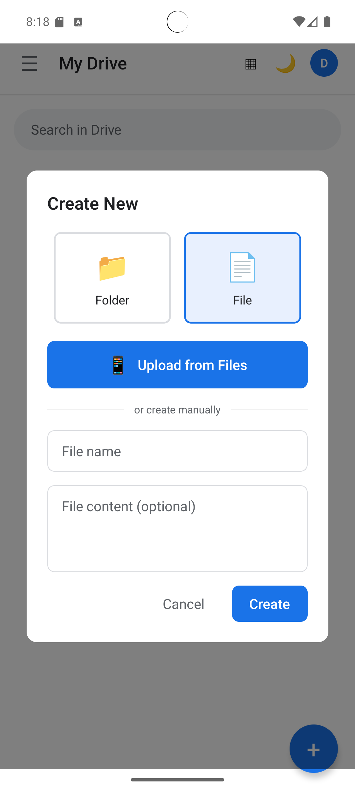
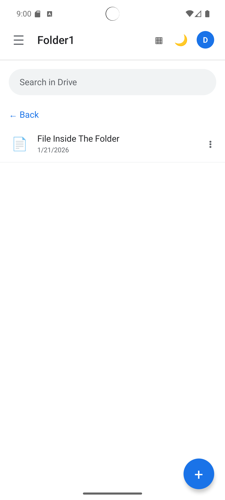
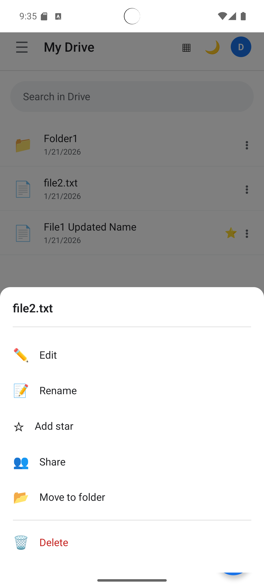
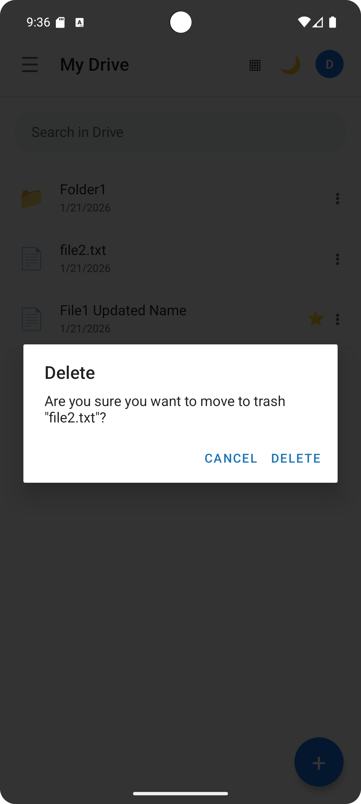
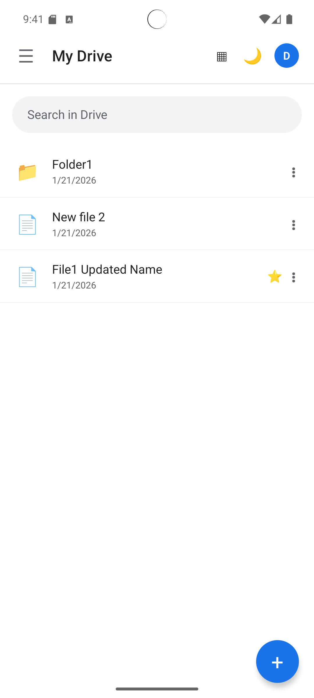
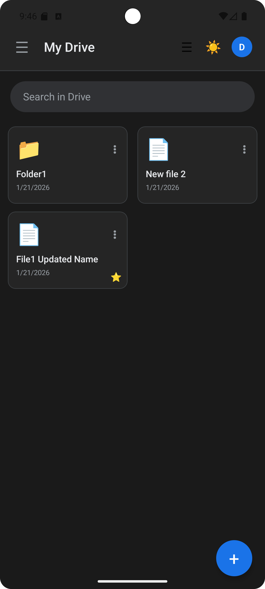
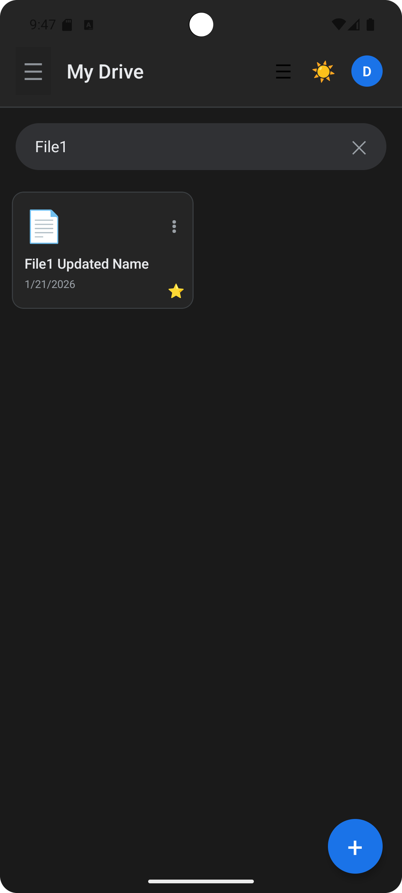

# File Operations

This guide covers creating, editing, viewing, and deleting files and folders in the Drive App.

## Overview

The Drive App supports:
- Creating folders and text files
- Uploading files from device storage
- Editing file contents
- Renaming files and folders
- Moving items between folders
- Deleting items (trash and permanent)
- Starring important items

## Home Screen Layout

*Screenshot: Home screen with labeled components*

| Component | Description |
|-----------|-------------|
| Menu (☰) | Open navigation drawer |
| Search | Search files by name |
| View Toggle | Switch between list and block view |
| Dark Mode | Toggle dark/light theme |
| Files List | Your files and folders |
| Create (+) | Create new item |

## Creating Items

### Opening Create Menu

Tap the **+** button in the bottom-right corner.

*Screenshot: Create button location*

### Create Menu Options

*Screenshot: Create menu with options*

### Creating a Folder

1. Tap **+** button
2. Select **Folder** tab
3. Enter folder name
4. Tap **Create**

*Screenshot: Creating a new folder*

### Creating a Text File

1. Tap **+** button
2. Select **File** tab
3. Enter file name
4. Enter file content (optional)
5. Tap **Create**

*Screenshot: Creating a new text file*

### Uploading from Device Storage

1. Tap **+** button
2. Tap **"Upload from Files"** button
3. Navigate to file location (e.g., Downloads)
4. Select file
5. File is uploaded automatically

*Screenshot: Upload from files button*

*Screenshot: Device file picker*

*Screenshot: File uploaded successfully*

## Navigating Folders

### Opening a Folder

Tap on any folder to open it and view its contents.

*Screenshot: Tapping to open a folder*

### Folder Contents

Inside a folder, you'll see:
- Back navigation (folder path)
- Folder contents
- Create button for new items

*Screenshot: Inside a folder view*

### Going Back

Tap the **back arrow** or folder path to navigate up.

*Screenshot: Back navigation*

## File Actions

### Opening Action Menu

**Long press** on any file or folder to open the action menu.

*Screenshot: Long pressing an item*

### Action Menu Options

*Screenshot: Action menu with all options*

| Action | Description |
|--------|-------------|
| Open | View file contents |
| Edit | Modify file content |
| Rename | Change item name |
| Move | Move to another folder |
| Star/Unstar | Mark as important |
| Share | Share with other users |
| Delete | Move to trash |

## Editing Files

### Step 1: Open Edit Mode

Long press file → Select **Edit**

*Screenshot: Edit option in menu*

### Step 2: Modify Content

Edit the file content in the text area.

*Screenshot: Editing file content*

### Step 3: Save Changes

Tap **Save** to save your changes.

*Screenshot: Save button*

## Renaming Items

### Step 1: Open Rename Dialog

Long press item → Select **Rename**

*Screenshot: Rename option*

### Step 2: Enter New Name

Type the new name and tap **Rename**.

*Screenshot: Rename dialog*

### Step 3: Item Renamed

The item now shows with its new name.

*Screenshot: Item with new name*

## Moving Items

### Method 1: Using Move Option

1. Long press item → Select **Move**
2. Select destination folder
3. Item is moved

*Screenshot: Move destination selection*

### Method 2: Drag and Drop

1. **Long press** the item to select it (turns blue)
2. Tap on a **folder** to drop the item into it
3. Confirm the move

*Screenshot: Item selected for moving*

*Screenshot: Folder highlighted as drop target*

## Starring Items

### Star an Item

Long press item → Select **Star**

*Screenshot: Star option*

### Viewing Starred Items

1. Open menu (☰)
2. Select **Starred**

*Screenshot: Starred items view*

## Deleting Items

### Move to Trash

Long press item → Select **Delete**

*Screenshot: Delete option*

*Screenshot: Delete confirmation dialog*

### Viewing Trash

1. Open menu (☰)
2. Select **Trash**

*Screenshot: Trash view with deleted items*

### Permanent Delete

In Trash view, long press item → Select **Delete permanently**

*Screenshot: Permanent delete option*

## View Options

### List View vs Block View

Toggle between views using the view button in the header.

**List View:**

*Screenshot: List view*

**Block View:**

*Screenshot: Block/grid view*

### Dark Mode

Toggle dark mode using the sun/moon button in the header.

**Light Mode:**

*Screenshot: Light mode*

**Dark Mode:**

*Screenshot: Dark mode*

## Search

### Searching Files

1. Tap the search icon
2. Enter search query
3. Results appear below

*Screenshot: Search functionality*

### Search Results

*Screenshot: Search results*

## Navigation Menu Views

Access different views from the navigation drawer:

| View | Description |
|------|-------------|
| My Drive | All your files |
| Starred | Favorited items |
| Recent | Recently accessed |
| Shared with me | Files shared by others |
| Trash | Deleted items |

*Screenshot: Navigation drawer with all views*

---

Next: [Sharing & Permissions](Sharing-Permissions.md)
