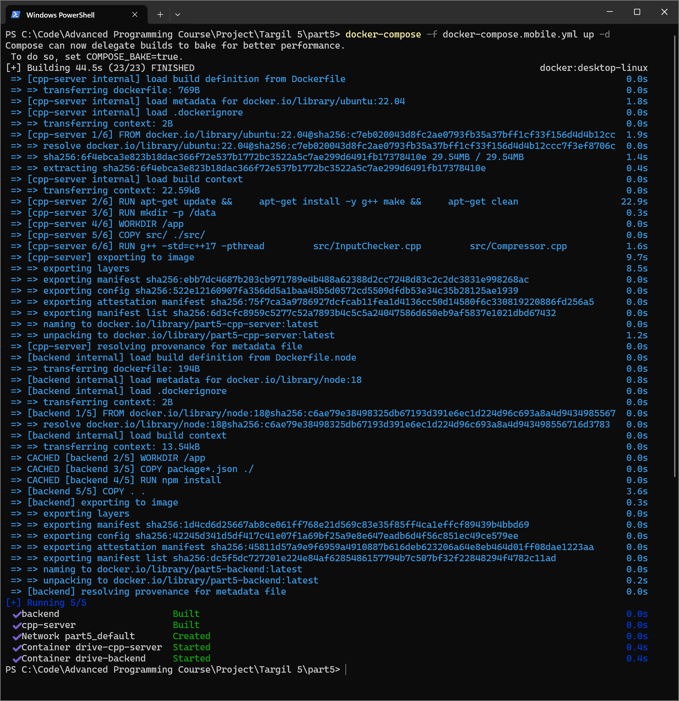
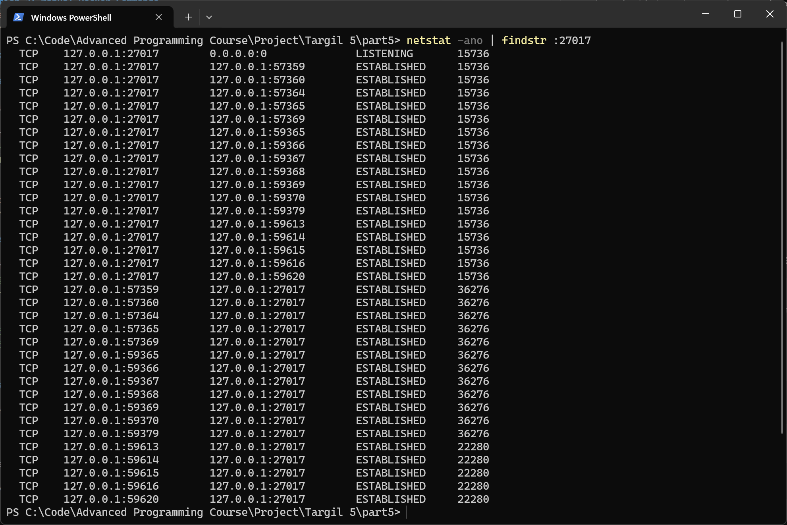
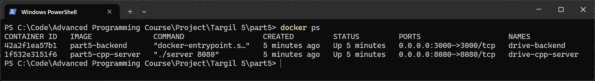
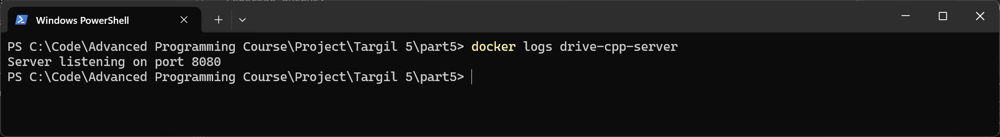
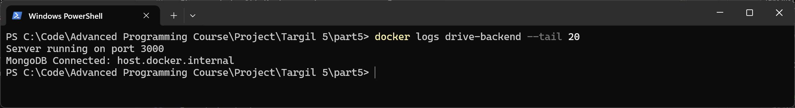
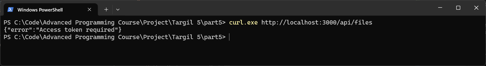
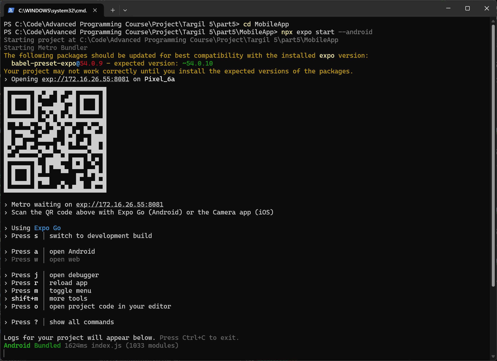
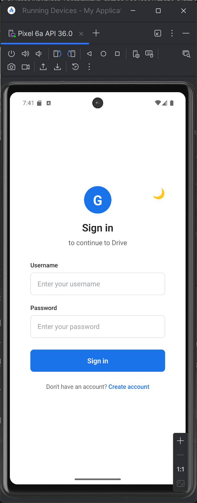

# Running the System

This guide explains how to start all services and run the complete Drive App system.

## System Components

| Component | Port | Technology |
|-----------|------|------------|
| MongoDB | 27017 | Database (metadata) |
| C++ Server | 8080 | File storage (RLE compression) |
| Backend API | 3000 | Node.js/Express |
| Mobile App | 8081 | React Native/Expo |

## Quick Start (One Command)

First, make sure the following are running on your machine:
   - MongoDB with the default connection: `mongodb://localhost:27017`
   - Docker Desktop
   - Android emulator (or device)

Now, use one of the following options:

### Option 1: Using the Startup Script

**Windows:**
```bash
# Double-click or run:
start-mobile-dev.bat
```


*Screenshot: Running the startup script*

### Option 2: Docker Commands

```bash
# Navigate to project directory
cd C:\<Project Directory>\part5

# Start C++ Server and Backend
docker-compose -f docker-compose.mobile.yml up -d
```


*Screenshot: Docker Compose starting services*

<br>After using one of the options, to run the android application execute the following:

```bash
cd MobileApp
npx expo start --android
```


## **Optional:** Manually building the application **without** Docker

### Step 1: Start MongoDB

Open MongoDb and create a new connection using the default settings:

   URI: `mongodb://localhost:27017`

Make sure your local MongoDB is running:

```bash
# Check if MongoDB is running
netstat -ano | findstr :27017
```


*Screenshot: MongoDB listening on port 27017*

### Step 2: Start C++ Server and Backend

```bash
# Using Docker (recommended)
docker-compose -f docker-compose.mobile.yml up -d

# This starts:
# - drive-cpp-server (port 8080)
# - drive-backend (port 3000)
```

### Step 3: Check Docker Status

```bash
docker ps
```

Expected output:
```
CONTAINER ID   IMAGE              PORTS                    NAMES
xxxx           part5-cpp-server   0.0.0.0:8080->8080/tcp   drive-cpp-server
xxxx           part5-backend      0.0.0.0:3000->3000/tcp   drive-backend
```


*Screenshot: All Docker containers running*

### Step 4: Verify C++ Server

```bash
# Check C++ server logs
docker logs drive-cpp-server
```

Expected output:
```
Server listening on port 8080
```


*Screenshot: C++ server running*

### Step 5: Verify Backend Server

```bash
# Check backend logs
docker logs drive-backend --tail 20
```

Expected output:
```
Server running on port 3000
MongoDB Connected: host.docker.internal
```


*Screenshot: Backend server logs*

### Step 6: Test API Endpoint

```bash
curl http://localhost:3000/api/files
```

Expected response:
```json
{"error":"Access token required"}
```

This confirms the backend is running and authentication is working.


*Screenshot: Backend server response*

### Step 7: Start Mobile App

Open a **new terminal** window:

```bash
cd MobileApp
npx expo start --android
```

### Step 8: Wait for Bundling

The Metro bundler will compile the app. Wait for the bundling to complete:

```
Android Bundled
```


*Screenshot: Metro bundler compilation complete*

### Step 9: App Running on Emulator

The app should automatically open on your Android emulator.

<br>
*Screenshot: Drive App running on Android emulator*

## Stopping the System

### Stop All Docker Services

```bash
# Using script
stop-mobile-dev.bat

# Or manually
docker-compose -f docker-compose.mobile.yml down
```

### Stop Expo

Press `Ctrl+C` in the terminal where Expo is running.

## Service URLs

| Service | URL |
|---------|-----|
| Backend API | http://localhost:3000/api |
| C++ Server | tcp://localhost:8080 |
| Expo Dev Server | http://localhost:8081 |
| MongoDB | mongodb://localhost:27017/driveDB |

## Verifying Everything Works

### 1. Check all ports are listening

```bash
netstat -ano | findstr ":3000 :8080 :27017 :8081"
```


*Screenshot: All services listening on their ports*

### 2. Check all Docker containers

```bash
docker ps
```

You should see:
- `drive-cpp-server` running on port 8080
- `drive-backend` running on port 3000

### 3. Test C++ server connection

```bash
# From Docker
docker exec drive-backend sh -c "echo 'get test' | nc cpp-server 8080"
```

### 4. Test API endpoint

```bash
curl http://localhost:3000/api/users -X POST -H "Content-Type: application/json" -d "{\"username\":\"test\"}"
```

### 5. Check emulator connection

```bash
adb devices
```

## Data Storage

### File Content Storage

Files are stored in the `/data` directory:
- Mounted from host `./data` to container `/data`
- Files are compressed using RLE
- Named by their storageKey (UUID generated by MongoDB)

```bash
# View stored files
ls -la ./data
```

### Metadata Storage

File metadata is stored in MongoDB:
- Database: `driveDB`
- Collections: `files`, `users`, `permissions`

## Troubleshooting

### Port already in use

```bash
# Find process using port 3000
netstat -ano | findstr :3000

# Kill process (replace PID)
taskkill /F /PID <PID>
```

### Docker container not starting

```bash
# View container logs
docker logs drive-cpp-server
docker logs drive-backend

# Rebuild containers
docker-compose -f docker-compose.mobile.yml up -d --build
```

### C++ server connection failed

```bash
# Check if C++ server is running
docker ps | grep cpp-server

# Check backend environment variables
docker exec drive-backend env | grep CPP

# Expected:
# CPP_SERVER_HOST=cpp-server
# CPP_SERVER_PORT=8080
```

### Files not appearing in data folder

1. Check volume mount in docker-compose.mobile.yml
2. Ensure `./data` directory exists on host
3. Check file permissions
4. Verify C++ server is receiving commands:
   ```bash
   docker logs drive-cpp-server
   ```

### Expo not connecting to emulator

```bash
# Restart ADB
adb kill-server
adb start-server
adb devices

# Manually open Expo URL
adb shell am start -a android.intent.action.VIEW -d "exp://YOUR_IP:8081"
```

### Backend can't connect to MongoDB

```bash
# Verify MongoDB is running
netstat -ano | findstr :27017

# Check backend logs for connection error
docker logs drive-backend | grep MongoDB
```

---

Next: [Authentication](Authentication.md)
