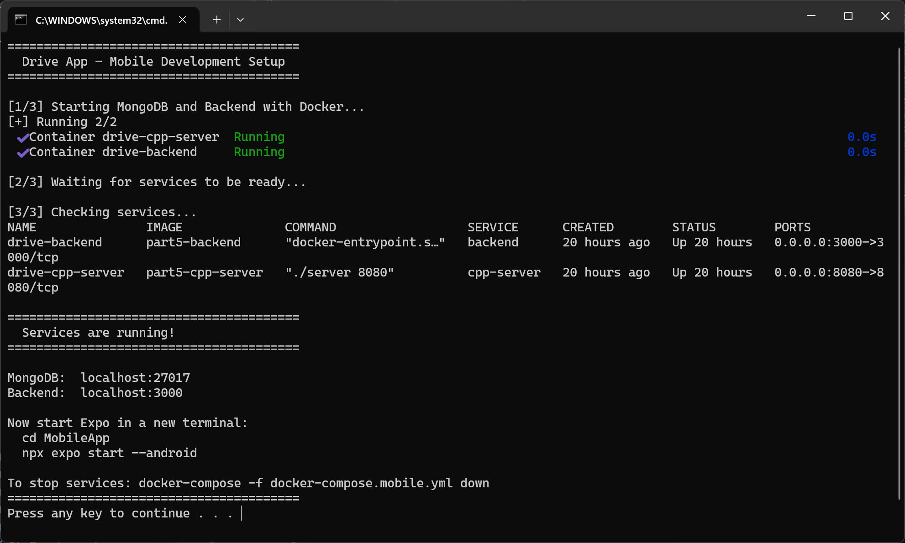
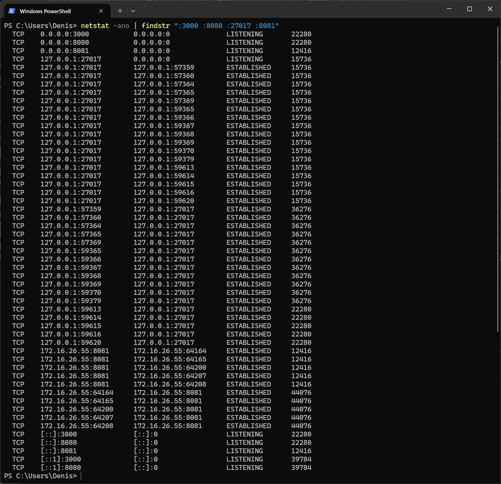

# Running the System

This guide explains how to start all services and run the complete Drive App system.

## System Components

| Component | Port | Technology |
|-----------|------|------------|
| MongoDB | 27017 | Database |
| Backend API | 3000 | Node.js/Express |
| Mobile App | 8081 | React Native/Expo |

## Quick Start (One Command)

### Option 1: Using the Startup Script

**Windows:**
```bash
# Double-click or run:
start-mobile-dev.bat
```


*Screenshot: Running the startup script*

### Option 2: Manual Docker Commands

```bash
# Navigate to project directory
cd c:\Users\nick\Desktop\tamam\part5

# Start MongoDB and Backend
docker-compose -f docker-compose.mobile.yml up -d
```


*Screenshot: Docker Compose starting services*

## Step-by-Step Guide

### Step 1: Start MongoDB

Make sure your local MongoDB is running, or start the Docker MongoDB:

```bash
# Check if MongoDB is running
netstat -ano | findstr :27017
```


*Screenshot: MongoDB listening on port 27017*

### Step 2: Start Backend Server

```bash
# Using Docker (recommended)
docker-compose -f docker-compose.mobile.yml up -d

# Verify backend is running
curl http://localhost:3000/api/files
```

Expected response:
```json
{"error":"Access token required"}
```

This confirms the backend is running and authentication is working.


*Screenshot: Backend server response*

### Step 3: Check Docker Status

```bash
docker ps
```

Expected output:
```
CONTAINER ID   IMAGE           PORTS                    NAMES
xxxx           part5-backend   0.0.0.0:3000->3000/tcp   drive-backend
```


*Screenshot: Docker containers status*

### Step 4: View Backend Logs

```bash
docker logs drive-backend --tail 20
```

Expected output:
```
Server running on port 3000
MongoDB Connected: host.docker.internal
```


*Screenshot: Backend server logs*

### Step 5: Start Mobile App

Open a **new terminal** window:

```bash
cd MobileApp
npx expo start --android
```


*Screenshot: Expo Metro bundler starting*

### Step 6: Wait for Bundling

The Metro bundler will compile the app. Wait for the bundling to complete:

```
Bundling complete - 1234ms
```


*Screenshot: Metro bundler compilation complete*

### Step 7: App Running on Emulator

The app should automatically open on your Android emulator.


*Screenshot: Drive App running on Android emulator*

## Stopping the System

### Stop Backend and MongoDB

```bash
# Using script
stop-mobile-dev.bat

# Or manually
docker-compose -f docker-compose.mobile.yml down
```

### Stop Expo

Press `Ctrl+C` in the terminal where Expo is running.

## Service URLs

| Service | URL |
|---------|-----|
| Backend API | http://localhost:3000/api |
| Expo Dev Server | http://localhost:8081 |
| MongoDB | mongodb://localhost:27017/driveDB |

## Verifying Everything Works

### 1. Check all ports are listening

```bash
netstat -ano | findstr ":3000 :27017 :8081"
```


*Screenshot: All services listening on their ports*

### 2. Test API endpoint

```bash
curl http://localhost:3000/api/users -X POST -H "Content-Type: application/json" -d "{\"username\":\"test\"}"
```

### 3. Check emulator connection

```bash
adb devices
```

## Troubleshooting

### Port already in use

```bash
# Find process using port 3000
netstat -ano | findstr :3000

# Kill process (replace PID)
taskkill /F /PID <PID>
```

### Docker container not starting

```bash
# View container logs
docker logs drive-backend

# Rebuild container
docker-compose -f docker-compose.mobile.yml up -d --build
```

### Expo not connecting to emulator

```bash
# Restart ADB
adb kill-server
adb start-server
adb devices

# Manually open Expo URL
adb shell am start -a android.intent.action.VIEW -d "exp://YOUR_IP:8081"
```

---

Next: [Authentication](Authentication.md)
