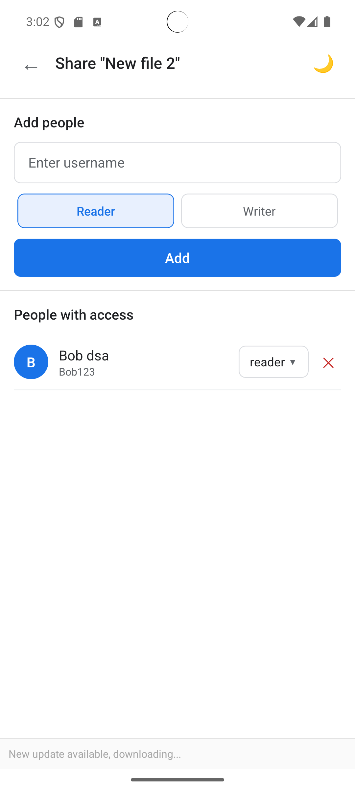
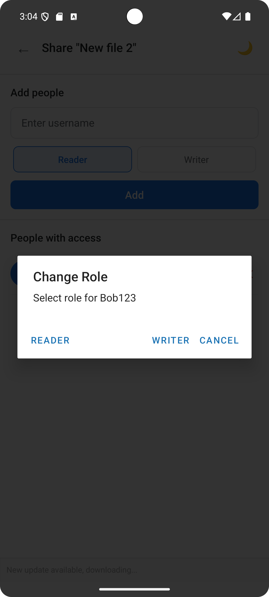
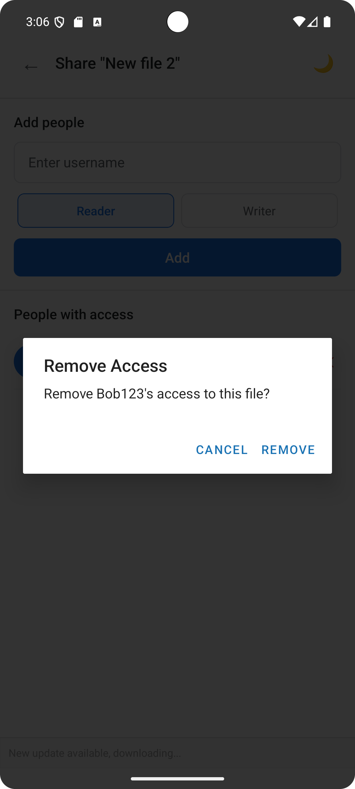
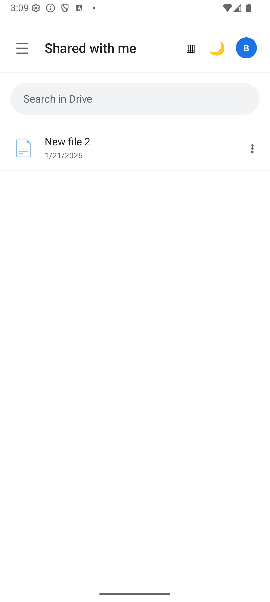
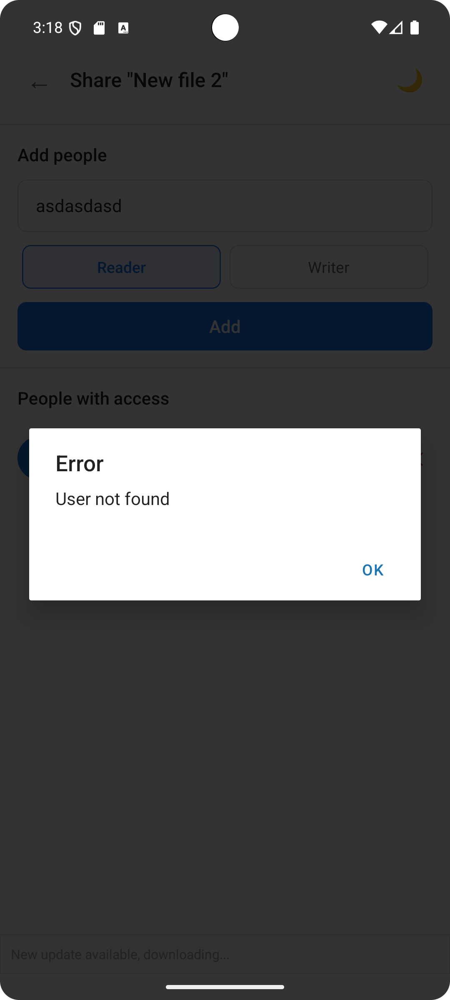
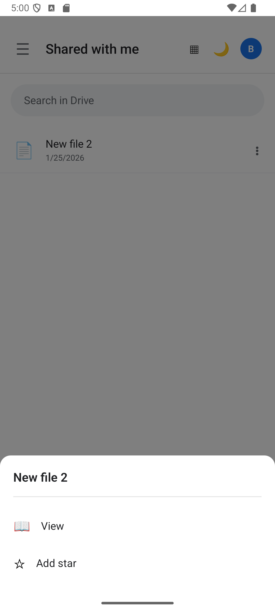

# Sharing & Permissions

This guide covers sharing files and folders with other users and managing permissions.

## Overview

The Drive App supports sharing files and folders with different permission levels:

| Role | Permissions |
|------|-------------|
| **Owner** | Full control - read, write, delete, share |
| **Writer** | Can read and edit content |
| **Reader** | Can only view content |

## Sharing a File

### Step 1: Open Action Menu

Press **⋮** on the file or folder you want to share.

<br>
*Screenshot: Pressing item to share*

### Step 2: Select Share

Tap **Share** from the action menu.

### Step 3: Share Screen

The Share screen opens showing:
- File name being shared
- Add people section
- Current permissions list

<br>
*Screenshot: Share screen layout*

## Adding Users

### Step 1: Enter Username

Type the username of the person you want to share with.

### Step 2: Select Permission Level

Choose the permission level:
- **Reader** - Can only view
- **Writer** - Can view and edit

### Step 3: Add User

Tap the **Add** button.

<br>
*Screenshot: Add button*

### Step 4: User Added

The user now appears in the permissions list.

<br>
*Screenshot: User added to permissions*

## Managing Permissions

### Viewing Current Permissions

The "People with access" section shows all users with access.

<br>
*Screenshot: List of people with access*

### Changing Permission Level

1. Tap on the role dropdown next to a user
2. Select new role (Reader/Writer)

<br>
*Screenshot: Role change dropdown*

<br>
*Screenshot: Role successfully changed*

### Removing Access

1. Tap the **X** button next to a user
2. Confirm removal

<br>
*Screenshot: Remove access confirmation*

## Accessing Shared Files

### Step 1: Open Menu

Tap the menu icon (☰) to open the navigation drawer.

### Step 2: Select "Shared with me"

Tap **Shared with me** from the menu options.

<br>
*Screenshot: Shared with me option*

### Step 3: View Shared Files

See all files that others have shared with you.

<br>
*Screenshot: List of shared files*

## Permission Inheritance

When you share a **folder**, the permissions apply to:
- The folder itself
- All files inside the folder
- All subfolders and their contents

## Permission Levels Explained

### Owner
- Original creator of the file
- Cannot be changed or removed
- Can do everything

### Writer
- Can view file content
- Can edit file content
- Can rename the file
- Cannot delete the file
- Cannot share with others

### Reader
- Can only view file content
- Cannot edit or modify
- Cannot rename
- Cannot delete
- Cannot share with others

## Share Screen Components

<br>
*Screenshot: Share screen with labeled components*

| Component | Description |
|-----------|-------------|
| Back Button | Return to previous screen |
| File Name | Name of file being shared |
| Username Input | Enter username to add |
| Role Selector | Choose Reader or Writer |
| Add Button | Add user with selected role |
| People List | Users with current access |
| Role Badge | Shows user's permission level |
| Remove Button | Remove user's access |

## Error Handling

### User Not Found

If the username doesn't exist:

<br>
*Screenshot: User not found error*

**Solution:** Verify the username is correct and the user is registered.

### Already Has Access

If the user already has permission:

<br>
*Screenshot: User already has access error*

**Solution:** Modify their existing permission instead.

### Permission Denied

If you're not the owner:


*Screenshot: Permission denied error*

**Solution:** Only the file owner can manage sharing.

## API Endpoints

### Get Permissions
```
GET /api/files/:fileId/permissions
Authorization: Bearer <token>
```

### Grant Permission
```
POST /api/files/:fileId/permissions
Authorization: Bearer <token>
Content-Type: application/json

{
  "userId": "user_id_here",
  "role": "reader"  // or "writer"
}
```

### Update Permission
```
PATCH /api/files/:fileId/permissions/:permissionId
Authorization: Bearer <token>
Content-Type: application/json

{
  "role": "writer"
}
```

### Revoke Permission
```
DELETE /api/files/:fileId/permissions/:permissionId
Authorization: Bearer <token>
```

---

Next: [API Reference](API-Reference.md)
